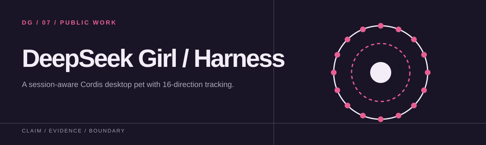
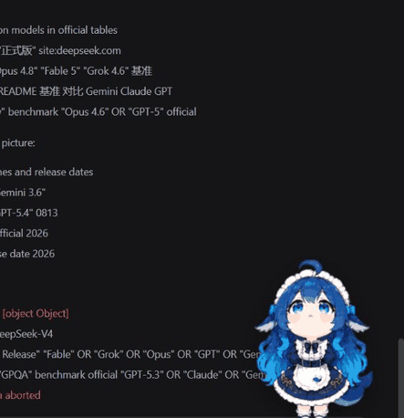

[獨立繁體中文 README](README.zh-TW.md)

<p align="center">
  
</p>

# deepseek娘 DeepSeek Harness 桌寵

一個給 DeepSeek Harness Web UI 使用的開源 Cordis 桌寵外掛。她會待在介面右下角，依照目前 Session 狀態切換動畫，也會用 16 個方向跟著滑鼠看。

> 實際在 DeepSeek Harness 中使用的畫面：
>
> 

> 這是社群製作的非官方外掛，不會修改 Session 資料、對話記錄或 DeepSeek Harness 核心原始碼。

## 功能

- 它是 DeepSeek Harness 原生的 Cordis 外掛，掛在 `shell.overlay` 擴充槽上。
- 待機時她拿著寫有簡體「区」的板子，對話框裡的字則維持「凶」。
- Harness 執行任務時，她會切換到工作動畫。
- Session 等待互動時，她會切換到等待動畫。
- 她會朝 16 個方向追著滑鼠看，每 22.5 度一格。
- 滑鼠停止 1.1 秒後，她會回到拿板子的待機動畫。
- 點一下桌寵，可以在一般與放大尺寸之間切換。
- 外掛支援 `prefers-reduced-motion`。
- 圖集採用 Codex pet v2 格式：1536 × 2288 的 WebP，8 × 11 格，每格 192 × 208。

## 相容性

| 外掛版本 | 需要的 DeepSeek Harness |
|---|---|
| 0.2.0 | `0.1.2-alpha.1` 的來源介面；更高版本待驗證 |
| 0.1.1 | `0.1.0-rc.6` ～ `0.1.1-rc.2` |

官方在 `0.1.2-alpha.1` 移除了舊的 `dsh-client-runtime` 套件，也把 pending interaction 從 session summary 移到獨立的 snapshot map。因此從 0.2.0 起，外掛改用 `dsh-client-ui-renderer`／`dsh-client-ui-session` 取得 slots 與 Session 狀態，並改讀獨立的 `useSessionPendingInteraction` snapshot。

桌寵可以和其他 web profile 外掛同時安裝。我們用官方的 `cordis-plugin-include`，對五層疊層做過組合驗證，依序是 `dsh-base`、`dsh-web-app`、dsh-web 全家桶 `@linxin666/dsh-web-all`、本外掛與 `dsh-plugin-verified-search`。結果是 169 個 entries，沒有重複的 id，沒有缺漏，也沒有警告。dsh-web 各套件的 HTTP 路由，也沒有和本外掛的 spritesheet 路由衝突。

要注意的是，dsh-web 內建的桌寵 `@linxin666/dsh-pet` 預設也出現在右下角，所以兩隻桌寵在畫面上會重疊。內建桌寵可以拖曳，也可以在「Web 插件 → 桌寵」設定裡隱藏。兩者在 API 層互不衝突，只要擇一顯示或把其中一隻拖開即可。

## 固定版本下載

固定版本的 TGZ 與它的 SHA-256 放在 [0.2.0 TGZ 與 SHA-256](https://github.com/f0909172434/dsh-deepseek-girl-pet/releases/tag/v0.2.0)。如何重現、驗證與還原，寫在 [重現、驗證與還原](RELEASE.md)。

## 安裝

### 一行安裝

```powershell
dsh plugin --profile web add github:f0909172434/dsh-deepseek-girl-pet#v0.2.0
```

安裝後要重新啟動 Harness：

```powershell
# 先在原本執行 dsh web 的視窗按 Ctrl+C，確認 3080 已停止，再執行：
dsh web
```

如果看到 `EADDRINUSE: address already in use 127.0.0.1:3080`，代表舊的 Harness 還在執行，並不是安裝失敗。請先回到原本的 Harness 終端機按 `Ctrl+C`，再重新執行 `dsh web`，最後在瀏覽器按 `Ctrl+F5` 強制重新載入。

如果安裝時出現 `Issues with peer dependencies found`，請查看它列出的套件與版本，不要假定這個警告與本外掛無關。看到 `Done` 只表示套件管理的步驟完成了。請先用下面的指令確認設定，再檢查實際畫面與狀態切換：

```powershell
dsh --profile web --dump-config | Select-String deepseek-girl-pet
```

然後開啟 [http://127.0.0.1:3080/](http://127.0.0.1:3080/)。

### 從原始碼安裝

```powershell
git clone https://github.com/f0909172434/dsh-deepseek-girl-pet.git
cd dsh-deepseek-girl-pet
npm pack
dsh plugin --profile web add .\dsh-deepseek-girl-pet-0.2.0.tgz
```

## 狀態映射

| Harness 狀態 | 桌寵表現 |
|---|---|
| Idle | 拿著「区」板子待機，對話框顯示「凶」 |
| Running | 工作動畫 |
| Pending interaction | 等待互動動畫 |
| Pointer movement | 16 方向追視 |

外掛直接讀取 Harness 官方提供的狀態來源。待機與工作狀態來自 `useSessions` 的 Session summary，等待狀態來自 `useSessionPendingInteraction` 的等待互動 snapshot。它不會靠掃描 DOM 文字來猜狀態，因為那種做法很容易壞掉。

## 技術方式

- Host plugin 只做一件事：在 `/deepseek-girl-pet/spritesheet.webp` 提供固定的 WebP 圖集。
- Client plugin 只註冊 `shell.overlay` 這一個 slot。
- 外掛不修改 DeepSeek Harness 的核心檔案。
- 外掛不讀取也不寫入對話內容。
- 外掛不依賴外部 CDN 或任何追蹤服務。

## 驗證

新增的封裝校驗與 CI 涵蓋的範圍寫在 [RELEASE.md](RELEASE.md)。下列的圖集檢查與宿主畫面是先前留下的紀錄。這次更新的是封裝方式，並沒有在宿主上重新實測，所以不把它們當成新的實測結果。

- `node --check lib/index.js`
- `node --check lib/client.js`
- Hatch Pet deterministic v2 atlas validation：PASS
- 圖集 SHA-256：`234F24A97C18195A00C6093DA0090773E675993C169E92E7E13A24C37B323FA2`
- DeepSeek Harness 首頁、client module 與 spritesheet route：HTTP 200

## 授權與聲明

本專案採用 [MIT License](LICENSE)。

這是社群製作的非官方專案，與 DeepSeek、OpenAI 或 Codex 沒有從屬、合作或背書關係。`DeepSeek`、`Codex` 與相關名稱及標誌仍屬其各自權利人所有。

## 共用圖集來源

圖集只在一個地方維護，就是 [Codex pet](https://github.com/f0909172434/deepseek-girl-codex-pet) 的 `pet/spritesheet.webp`。本套件保留一份經過 hash 核對的副本，執行時不會下載圖集。host adapter 與安裝入口則由兩個 repo 各自維護。來源的完整 commit、路徑、SHA-256 與大小記在 [`atlas-source.json`](atlas-source.json)。

```bash
npm run atlas:check
node scripts/sync-atlas.mjs --source ../deepseek-girl-codex-pet
# 或從 manifest 指定的完整 commit 下載（需要網路）：
node scripts/sync-atlas.mjs --download
npm test
```

要更新圖集時，先在 Codex 那邊完成 QA，再明確更新 manifest 裡的 commit、hash、大小與 `SHA256SUMS`，同步之後跑測試。舊的 v0.2.0 release 保留原本的 bytes。目前 main 上新增的來源追蹤工具，並不代表推出了新的 host 功能版本。
